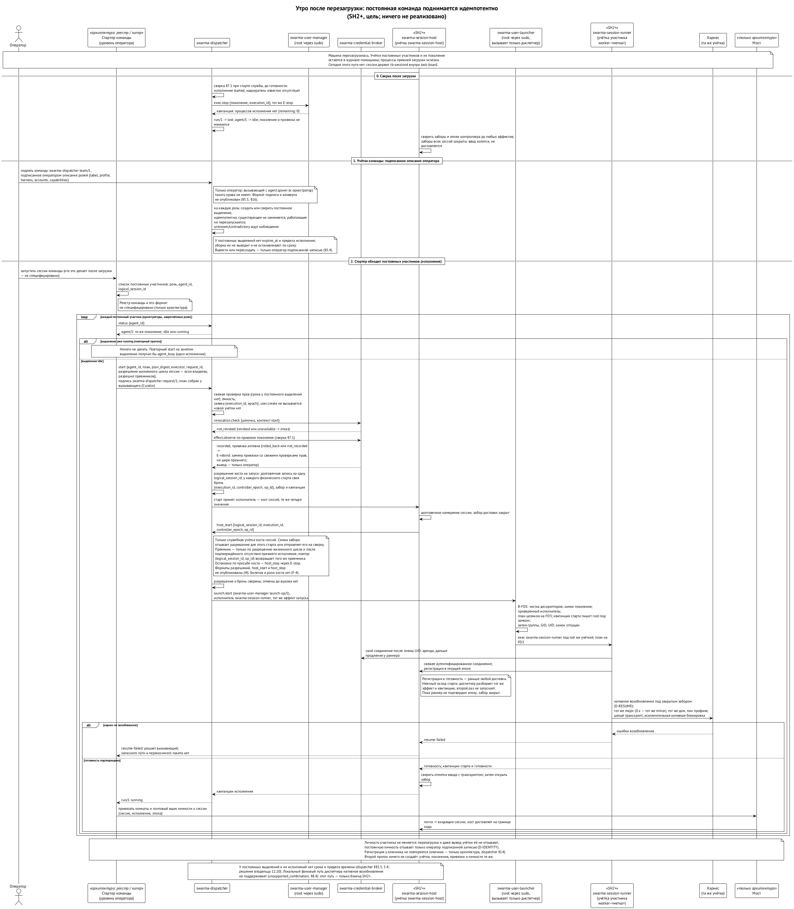

# Сценарии сквозь систему

Теперь пройдём систему насквозь — так, как через неё проходит работа. Каждый сценарий называет модули, которые в нём участвуют, и схему, где он нарисован подробно. Почти всё здесь — целевое устройство из спецификаций и решений; что работает уже сегодня, сказано в главе «Где мы».

## Утро после перезагрузки: кипер поднимает команду

{.tall}

Машина перезагрузилась. Диспетчер первым делом сверяет свои записи с реальностью: все исполнения, которые шли до перезагрузки, помечаются потерянными, а учётки постоянных участников остаются — их поколение то же. Сама команда — это подписанное оператором описание ролей (`swarma-dispatcher team/1`): по нему диспетчер идемпотентно создаёт или сверяет учётку каждой роли, и повтор ничего не дублирует. Сверка никогда сама не выводит и не пересоздаёт постоянную учётку — только оператор подписанной записью. Учётки поднимаются отдельно от исполнений: затем для каждого постоянного участника — кипера, оркестраторов, закреплённых специалистов — просят диспетчер запустить его долгую сессию. Кто именно просит после перезагрузки, спецификация пока не называет. ⟦открыто⟧ Новой учётки не создаётся, и предела по времени у этой сессии нет. Хост сессий просит старт через `host_start` по разрешению хоста на запуск, выданному на всю логическую сессию; если перед перезагрузкой владелец разрешил этой сессии преемников, новый старт идёт как преемник — после подтверждённого отсутствия прежнего исполнения и со свежим вердиктом отзыва. Диспетчер стартует раннер под той же учёткой, а хост сессий держит забор закрытым, пока раннер не подтвердит, что он именно этого исполнения и эпохи. Потом сессия возобновляется нативно, если версия среды сменилась без поломки по semver, а если не вышло — вызывающий получает «возобновление не удалось» и решает сам. Мост привязывает комнаты, забор открывается. Личность участника та же: вывод и подъём учётки её не трогают. Всё идемпотентно: второй прогон ничего не создаёт. ⟦спецификация⟧

Модули: диспетчер, менеджер пользователей и запускатель, хост сессий и раннер, брокер, мост; реестр и ключник — пока архитектура.

## Оркестратор берёт воркера

Оркестратор собирает через Curator план для разработчика и подписанной заявкой просит диспетчер запустить его. Диспетчер проверяет подпись и грант оркестратора на спавн этой роли, спрашивает у брокера вердикт об отзыве его цепочки, то, что запрошенные права ребёнка уже прав оркестратора, квоту и ёмкость машины; через менеджер пользователей создаёт временного пользователя `worker-<метка>` с домом и файрволом; привязывает новое поколение у брокера с листом гранта для агента. Для разовой работы запускатель стартует `curator-run` под этим пользователем, тот проверяет план и берёт токен у брокера; для долгой сессии запускатель стартует раннер сессии, и её ведёт хост сессий. Результат возвращается сообщением и становится предложением исхода. После завершения и подтверждённого отсутствия процессов, если у запуска была рабочая копия, сначала выгружается её результат: пока он не сохранён целиком или оператор не снял обязательство, дом не удаляется. Потом привязка снимается, ключи уничтожаются, дом удаляется, пользователь выводится; остаются только служебные метаданные. Личность разового воркера диспетчер отзывает отдельным шагом — когда появится ключник. Схема — «Разовый агент» в главе о запуске.

Модули: Curator и `curator-run`, диспетчер, менеджер пользователей и запускатель, брокер учётных данных, хост сессий, мост, доска; ключник — позже.

## Владелец выдаёт грант с телефона

Новому оркестратору проекта нужен грант на спавн. Владелец открывает на телефоне приложение оператора. Приложение заходит по SSH через tailnet в учётку `swarma-operator` ключом из защищённого чипа телефона; shell там нет, только операторская команда. Она отдаёт каноническое содержимое действия, и приложение показывает его точно: кому, какие действия, над какими аккаунтами и профилями, до какого срока. Владелец подтверждает биометрией, телефон подписывает запись оператора над этим содержимым, операторская команда проверяет подпись по закреплённому ключу телефона и передаёт грант брокеру. Подпись привязана к этому действию, и для другого её не используешь. Вечером владелец решает отозвать грант: одно касание с биометрией, и брокер записывает отзыв на диск до ответа. Если телефона под рукой нет, то же самое делается из терминала: `sudo` в `swarma-operator` с паролем и без кэша, с тем же подтверждением содержимого. А посмотреть, что сейчас выдано и кто к чему привязан, можно через учётку `swarma-observer` без всяких подтверждений. Ни в одной из этих учёток не работает ни одна сессия агента, поэтому инъекция в агента подписи владельца не получит. ⟦спецификация⟧ Схема — «Действие оператора с телефона» в главе о ключах.

Модули: приложение оператора, `sshd` и операторская команда, брокер учётных данных, менеджер пользователей.

## Человек пишет агенту с телефона

Владелец пишет в комнату проекта из обычного клиента. Клиентское приложение подписывает сообщение его ключом, подпись едет в метаданных. Провайдер моста сохраняет событие; ворота проверяют подпись, ключ владельца и грант; decision guard сверяет просьбу; хост сессий кладёт «звонок» в ввод агента на границе хода; агент читает из почтового ящика тело и запись проверки и берётся за работу. Если бы сообщение пришло без подписи от постороннего участника комнаты, агент получил бы только звонок с метаданными и мог бы прочитать текст как недоверенные данные.

Модули: клиентское приложение, носитель, провайдер, мост, доверие, decision guard, хост сессий.

## Агент отвечает в комнату

Агент вызывает `post`. Мост проецирует вывод для аудитории — только итоговый текст, без вызовов инструментов; ключник подписывает от имени агента; провайдер публикует. Люди видят обычное сообщение; прямой выход агента в сеть закрыт файрволом.

## Делегированная команда из другой организации

Владелец выдал Алексею грант на перезапуск раннеров с правом передачи на один шаг; Алексей передал часть своему оркестратору. Оркестратор шлёт подписанную команду в общую комнату федеративного носителя. Наши ворота проходят цепочку до нашего корня и проверяют ослабление на каждом шаге; реестр называет обработчика; помощник раннеров перепроверяет цепочку сам, перезапускает раннер и подписывает квитанцию. Оркестратор Алексея видит её в той же комнате.

Модули: носитель (федерация), мост, доверие, реестр действий, обработчик.

## Новый удалённый агент

Человек с чужой машиной запускает `curator remote-worker init` с приглашением (схемы — в главе об удалённом рабочем месте); клиент сам проверяет нашу среду по HTTPS и DNSSEC; на его машине появляется мост с тремя ключами — в первом варианте под его же пользователем, в надёжном варианте — когда будет описан компонент подготовки донора — отдельной учёткой рядом с учёткой харнеса; мы сверяем заявку с приглашением или карточкой на бирже, закрепляем ключи, выдаём гранты и зашифрованный пакет; диспетчер с менеджером пользователей создаёт рабочее место; мост донора держит одно SSH-соединение к нам, забирает задачу из почтового ящика и подаёт её в харнес как следующий ход. Харнес запущен в запертом режиме: модели не предложено ни одного локального инструмента.

## Переезд оркестратора

Оркестратор нужно перенести на другую машину. Хост сессий закрывает забор, дожидается конца хода, записывает пакет передачи и подтверждает отсутствие процесса. На новой машине диспетчер создаёт пользователя, ключник с тем же мастер-секретом выводит тот же ключ по тому же пути — личность сохранилась; хост сессий посеивает пакет и открывает забор: между машинами нативное возобновление не работает, только пересборка из пакета. Старый пользователь выводится, а личность оркестратора как постоянная не отзывается.

## Логин среды протух

Хост сессий видит ошибку аутентификации и паркует сессию. Дальше предложение такое: брокер учётных данных запускает флоу входа провайдера и пересылает ссылку и код владельцу аккаунта на телефон; владелец подтверждает; брокер сообщает хосту сессий, хост сессий перезапускает сессию с новой арендой, и она продолжает работу с того же места. Спецификации у этого пути нет: кто за него отвечает, ещё решается, а доставка событий брокера хосту сессий отложена на поздние версии. ⟦открыто⟧

## Задача от постановки до приёмки

И наконец, всё вместе. Владелец ставит задачу на доске продукта. Задача входит в состояние «анализ» — роутер ролей запускает архитектора через диспетчер, тот получает пользователя, доступ к подписке и цель доски. Архитектор пишет анализ и говорит «готово» — ядро принимает исход и переводит задачу в «разработку». Разработчик получает срез контекста, работает в своём рабочем дереве, сеть — только через прокси профиля; закончил — «тестирование», затем «ревью». Ревьюер ставит вердикт; правила ядра требуют свидетельство ревью и подписанную перемотку точной головы — оркестратор интегрирует. Все сообщения шли через мост и были подписаны, все запуски проверены грантами, все пользователи после работы удалены. Владелец получил уведомление в чат.
