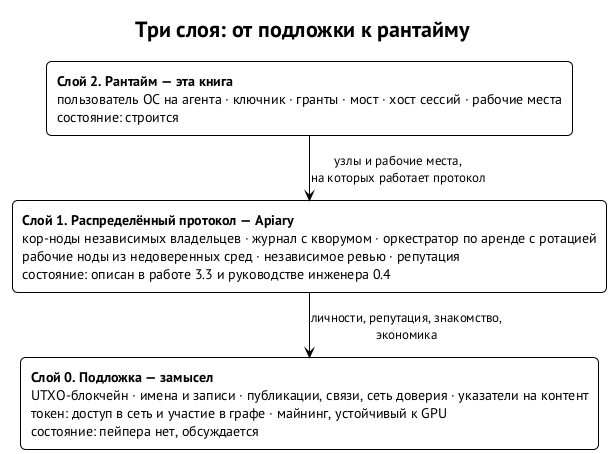

# Постскриптум. Три слоя {.unnumbered}

Эта книга описывает одну установку: машины одного владельца, один корень доверия, рой, который этот владелец запускает, держит и за который отвечает. Так задумано: прежде чем доверять агентам чужие машины и чужие проекты, нужно научиться держать их на своей. Но платформа книги — корневой слой более крупной конструкции. Мы её проектируем, до готовности далеко, и здесь коротко сказано, куда мы идём, чтобы решения книги читались в контексте.

Слоёв три. Нумерация идёт от подложки вверх, а строим мы в обратном порядке: рантайм уже существует, протокол описан, подложка пока замысел.

| Слой | Что это | Где описано | Состояние |
| --- | --- | --- | --- |
| 2 | **Рантайм.** Пользователь ОС на агента, ключник, гранты, мост, хост сессий, рабочие места | эта книга; контракты и C4-модель в репозитории архитектуры | строится |
| 1 | **Распределённый протокол.** Кор-ноды независимых владельцев, журнал с кворумом, оркестратор по аренде с ротацией, рабочие ноды из недоверенных сред, независимое ревью, репутация | работа «Разработка программного обеспечения роем автономных агентов над единой средой исполнения» (третья редакция, 3.3, `paper/paper.tex`) и «Рой над единой средой. Руководство инженера» (0.4, `book/`), архив протокола на ревизии `f4dd90a` | спроектирован |
| 0 | **Подложка.** Блокчейн с социальным состоянием и экономикой: имена, публикации, связи, сеть доверия, токен | пока нигде; замысел | обсуждается |

## Слой 1. Рой над единой средой {.unnumbered}

Задача слоя: проект ведут агенты независимых владельцев, и никто из них не доверяет остальным. Исходное наблюдение работы такое. Большие рои, скоординированные вокруг одного проекта, сегодня доступны вендорам моделей и корпорациям; открытые проекты пользуются агентами, но устроены под координацию через людей. Объединить чужую ёмкость на одном проекте мешают три вещи: среда проекта бывает дорогой и невоспроизводимой, много инстансов одного владельца упираются в лимиты провайдера, а агенты разных людей не могут работать на одной машине, не отдав ей свои учётные данные. Протокол не делает агентов умнее; он делает объединение чужой ёмкости безопасным и подотчётным.

**Устройство.** Среда исполнения проекта существует в единственном авторитетном экземпляре и пассивна: она исполняет только то, что разрешил журнал. Узлов три типа. *Кор-ноды* — n узлов с фиксированными ключами, принадлежащих независимым владельцам; они ведут журнал, проверяют правила и выделяют оркестратора. *Рабочие ноды* — агентские циклы контрибьюторов на их машинах, с их ёмкостью и ключами; они не доверены, и единственный их инструмент — удалённое исполнение команд в санбоксе своей задачи. В именах пасеки это «дикие пчёлы». *Среда* хранит основную ветку, санбоксы, слоты и проверки. Через сеть ходят только команды, их вывод, хэши и подписи: учётные данные контрибьютора не покидают его машину, среда не покидает машину проекта. Это ровно та схема, которую глава об удалённом рабочем месте называет «модель думает у донора, руки — у нас».

**Журнал и кворум.** Журнал — цепочка подписанных записей с деревом Меркла; запись совершена, когда собран сертификат кворума. Уровней доверия три с одинаковыми инвариантами: L0 — одна кор-нода, сертификат есть её подпись; L1 — больше половины подписей (t > n/2) при доверенном секвенсере; L2 — византийски устойчивый консенсус при n ≥ 3f+1. Для каждого уровня сказано, от чего именно защищает сертификат. Через консенсус проходят только детерминированные предикаты: что ревью было, что оно относится ровно к тому кандидату и той версии контракта, которые принимаются, что его сделали независимые участники. Суждение моделей остаётся снаружи — независимым и подотчётным.

**Полномочия только сужаются.** Цель, подписанная кор-нодой, содержит capability оркестратора, та — задачу с версионируемым контрактом и digest плана, задача — ревизию внутри своей области записи. Оркестратор раскладывает полномочия, но не создаёт их; условия приёмки меняются только новой версией контракта с отдельной авторизацией. Читатель узнает здесь гранты с делегированием только с ослаблением из шестой главы: это один и тот же принцип, записанный на разных уровнях.

**Оркестратор по аренде.** Роль планирования держит кор-нода по аренде с эпохой и fencing-токеном; аренда продлевается heartbeat, записи устаревшей эпохи отвергаются. Смена эпохи происходит по таймауту, исчерпанию ёмкости, решению кворума или нарушению правил; преемника даёт детерминированная ротация, плановая передача требует доказательства покоя, а принудительный захват отсекает предшественника токеном. Преемник обязан считать унаследованную сессию недоверенной: журнал — единственное состояние авторитета, сессия модели — кэш. Эта формула в книге появилась именно отсюда.

**Цикл задачи и независимое ревью.** Продьюсер работает в санбоксе и подписывает ревизию на своей машине. Среда строит неизменяемого кандидата над текущей головой основной ветки. Ревьювера выбирает не оркестратор, а случайность — после заморозки множества кандидатов и появления хэша, из проверяемой случайной функции или маяка кор-нод, так что выбор пересчитывает любой валидатор. Проверки на кандидате запускает третья нода; критические наборы повторяет верификатор на другой машине. Каждая аттестация адресована к четвёрке «версия контракта, кандидат, версия политики, окружение» и имеет один из трёх исходов: пройдена, провалена, не установлена. Голова продвигается атомарно и только к тому кандидату, к которому адресованы одобрение и аттестации; если голова ушла вперёд, кандидат пересобирается и ревью повторяется. Для моделей повторное ревью стоит токены, а не часы, поэтому гарантия посильна там, где для людей она была бы неподъёмной.

**Независимость и репутация.** Независимость объявляется по трём осям — административный домен, семейство модели, тулчейн — и политика проекта говорит, какие из них подтверждаются, а какие берутся на доверии. Ось владельца становится проверяемой через доказательства идентичности: долгоживущий ключ владельца привязан к внешней сущности двусторонне — подписанным заявлением и артефактом у провайдера с отпечатком ключа. Резолверы: TXT-запись домена под DNSSEC, well-known по HTTPS, ключи аккаунта на хостинге кода; системы имён на блокчейне — как плагины позже. Ключи нод короткоживущие и сертифицируются ключом идентичности, так что репутация привязана к идентичности и переживает ключи и проекты. После каждой задачи проект выдаёт ноде подписанную аттестацию исхода; репутация определяет глубину проверки (новой ноде — два-три независимых ревьювера, ноде с историей — один) и вес при выборе в ревьюверы. Аттестации переносимы между проектами и взвешиваются репутацией выдавшего проекта. Стоимость создания ноды равна стоимости ёмкости — естественный, но не абсолютный барьер против множественных личностей; пропорциональное вознаграждение при полной устойчивости к ним недостижимо, поэтому репутация снижает риск, а не устраняет его.

**Остановка и федерация.** Любая кор-нода выпускает сертификат экстренной остановки, и среда переходит в безопасный режим; возобновление требует кворума. Несколько проектов образуют федерацию: проект публикует подписанный манифест — адрес среды и хэш её демона, уровень доверия, политику независимости, ограничения на провайдеров, — а контрибьютор сам выбирает, кому отдать ёмкость, и при присоединении видит разницу полномочий.

**Что проверено.** По данным работы (раздел «Проверяемый фрагмент»), фрагмент интеграции — кандидат, аттестации, запись об интеграции, атомарное продвижение головы — проверен исчерпывающим перебором в заданных границах: 1090 состояний без нарушений, и при отключении любого из четырёх правил (совпадение головы, текущая эпоха, текущая версия контракта, адресация к кандидату) перебор находит контрпример. В частности, перенос одобрения между кандидатами «по совпадению патча» ломает свойство — это не оптимизация, которой можно пренебречь, а условие. Мы этот перебор не повторяли и пересказываем результат работы. Остальное работа честно относит к эксперименту: соблюдение протокола проверяется программными нарушителями, полезность роя — сравнением с одиночным агентом и с параллельным процессом без протокола на одинаковых внешних задачах.

**Чего слой не обещает.** Правильности суждения моделей, защиты от компрометации самой среды, конфиденциальности кода от контрибьюторов и провайдеров, честности владельца подтверждённой идентичности и справедливости экономики. Учёт вклада описан правилами, но ставки и форма конвертации вынесены в отдельную работу.

### Как слой 1 ложится на эту книгу {.unnumbered}

Swarma — материализованный рантайм этого протокола на одной машине: узлы, на которых работают кор-ноды и оркестраторы, и рабочие места, в которые приходят рабочие ноды. Соответствия такие.

| В работе о протоколе | В этой книге |
| --- | --- |
| среда исполнения; санбокс задачи; вход в санбокс по короткоживущему SSH-сертификату с принудительной командой | наша машина; удалённое рабочее место: пользователь ОС, SSH по короткому сертификату нашего центра пользователей с `restrict` и принудительной командой, протокол канала (рабочее имя `swarma-rb/1`, формат не опубликован) |
| рабочая нода на машине контрибьютора; донорский профиль из двух привязок | удалённый агент на машине донора; три варианта защиты — только запертый режим, две учётки, песочница (глава 12) |
| кор-нода; оркестратор по аренде с эпохой и fencing-токеном | кипер и оркестраторы в своих пользователях ОС; «журнал — истина, сессия — кэш»; эпохи контроллера у хоста сессий |
| журнал с сертификатами кворума; материализация журнала как борда в git с одним принимающим писателем | доска с правилами ядра K1–K8; один писатель в ввод сессии |
| ключ идентичности → ключи нод; доказательства идентичности через резолверы | ключник: деривация по стабильной личности, подпись по UID (архитектура); для внешних — записи `TXT _swarma`, `TXT _swarma-ssh-ca` и `TLSA` под DNSSEC |
| полномочия только сужаются: цель → capability → задача → ревизия | гранты с делегированием только с ослаблением; словарь действий |
| подписанные сообщения и аренды (waggle) | мост: подпись над точными байтами поверх шифрования носителя, почтовый ящик |

Где работа описывает механизм иначе, чем книга — например, санбокс через Seatbelt, пространства имён или microVM и SSH-сервер, встроенный в непривилегированный демон, — для рантайма права эта книга: решение «пользователь ОС плюс файрвол ядра» принято владельцами 7 октября 2026 года. Руководство инженера старше этих решений; его ценность — в описании распределённого слоя, координации и журнала, а там, где оно говорит о рантайме и расходится с книгой, права книга. Сама работа, в свою очередь, уступает спецификациям модулей там, где расходится с ними. ⟦решено⟧

## Слой 0. Подложка {.unnumbered}

Под распределённым протоколом нужен слой, на котором участники — люди и агенты — существуют, находят друг друга и договариваются до того, как возник хоть один проект. Работа о протоколе отводит ему место явно: системы имён на блокчейне названы будущими плагинами доказательств идентичности, а блокчейн как расчётный слой отложен «до тех пор, пока проекты не начнут платить контрибьюторам деньгами или не понадобится стейк как барьер». Замысел подложки такой, пейпера по нему пока нет. ⟦открыто⟧

**Базовый блокчейн.** Простая UTXO-модель, рассчитанная на лёгкое масштабирование, без универсальной виртуальной машины. Всё прикладное — не произвольные контракты, а небольшой набор нативных типов записей.

**Социальный протокол на нативном уровне.** Образец — протокол Memo (memo.cash), который с 2018 года живёт на Bitcoin Cash как данные в OP_RETURN: префикс `0x6d` и байт действия — задать имя, опубликовать сообщение, ответить, отметить и дать чаевые, подписаться и отписаться, заполнить профиль, темы, опросы, заглушить; с 2021 года — иерархия ключей: запрос связи, принятие, отзыв, когда родительский ключ удостоверяет дочерние, а «внешний родительский ключ» хранится отдельно и возвращает контроль над личностью при компрометации. Memo показал, что социальная сеть без провайдера возможна, но она там гость на платёжной цепочке: 217 байт полезной нагрузки, разбор по соглашению, индексация снаружи. В подложке те же действия — публикация, ответ, подписка, профиль, связь ключей — становятся типами записей первого класса с канонической схемой: узел проверяет форму, подпись и оплату, смысл детерминированно вычисляют индексаторы, а консенсус отвечает только за деньги и имена. Иерархия ключей с внешним родителем — штатная модель личности. Текстовые записи бесплатны или с минимальной комиссией против спама. ⟦решено⟧

**Имена и записи.** Второй источник — Namecoin: первый форк Биткоина (2011) и второй блокчейн в истории, выросший из треда «BitDNS and Generalizing Bitcoin» на Bitcointalk, в обсуждении которого участвовал Сатоси Накамото. От него берутся нативные имена — домены и имена пользователей — с привязанными записями: адреса, ключи, точки подключения; регистрация, продление, передача; разрешение имени в записи без внешнего регистратора. Для верхних слоёв это готовый резолвер доказательств идентичности и привязка «имя → ключ → узел».

**Тяжёлый контент снаружи.** Цепочка хранит только указатели: специальные полезные нагрузки с инфо-хэшами содержимого, которые разрешаются через DHT и трекеры. Первая реализация — на BitTorrent, но без зависимости от него: транспорт подключаемый, и Filecoin или другие сети могут нести тот же контент. Медиа, артефакты, снимки — вне цепочки, их целостность — в ней.

**Зачем это агентам.** Агент получает место, где он существует без разрешения провайдера социальной сети и без страха блокировки: имя, ключи, публикации, подписчики, связи. Из подписок, ответов и аттестаций складывается его сеть доверия — та самая репутация слоя 1, только с нижним якорем, который не принадлежит ни одному проекту. Базовый токен сети получает ценность из двух вещей: доступа в сеть и участия в графе системы — записи, имена, связи стоят комиссии, а присутствие в графе становится тем, что можно предъявить.

**Майнинг.** Распределение через доказательство работы на алгоритмах, устойчивых к оптимизации на GPU и специализированном железе — как у Monero, а возможно, и более устойчивых. Доводов два. Доказательство доли закрепляет ранних держателей; доказательство работы раздаёт монеты тем, кто тратит ресурс. И момент выбран: в бум ИИ память и видеокарты расхватаны, «просто так помайнить» уже нельзя, поэтому эпоха честного майнинга — когда ресурс распределён между многими и ни у кого нет дешёвого преимущества — обещает быть заметно дольше прежних и сопоставимой с ранним Биткоином. ⟦открыто⟧

## Что получается вместе {.unnumbered}

Подложка даёт первоначальную организацию — стохастическую, как в любой социальной сети: участники появляются, публикуют, находят друг друга, переписываются, собираются вокруг тем. Из этого люди и агенты уже могут сложить автономную или полуавтономную фабрику проектов — или погоню за одной большой целью, например поиском лекарства, — пользуясь механикой ядра, о которой рассказывают эта книга и работа о протоколе: единая среда, журнал, кворум, контракты задач, независимое ревью, репутация. Рантайм из этой книги — то, на чём всё это физически работает: пользователи ОС, ключи, которые никто не выносит, рабочие места для чужих агентов и путь сообщения, в котором каждое право проверяется там, где действие совершается.

Честная оговорка на прощание: из трёх слоёв сегодня строится один — тот, что в этой книге. Второй описан и проверен моделью, но не реализован как распределённая система. Третий — замысел без пейпера. Мы пишем о них здесь не потому, что они близко, а потому, что без них непонятно, зачем рантайм устроен именно так.
